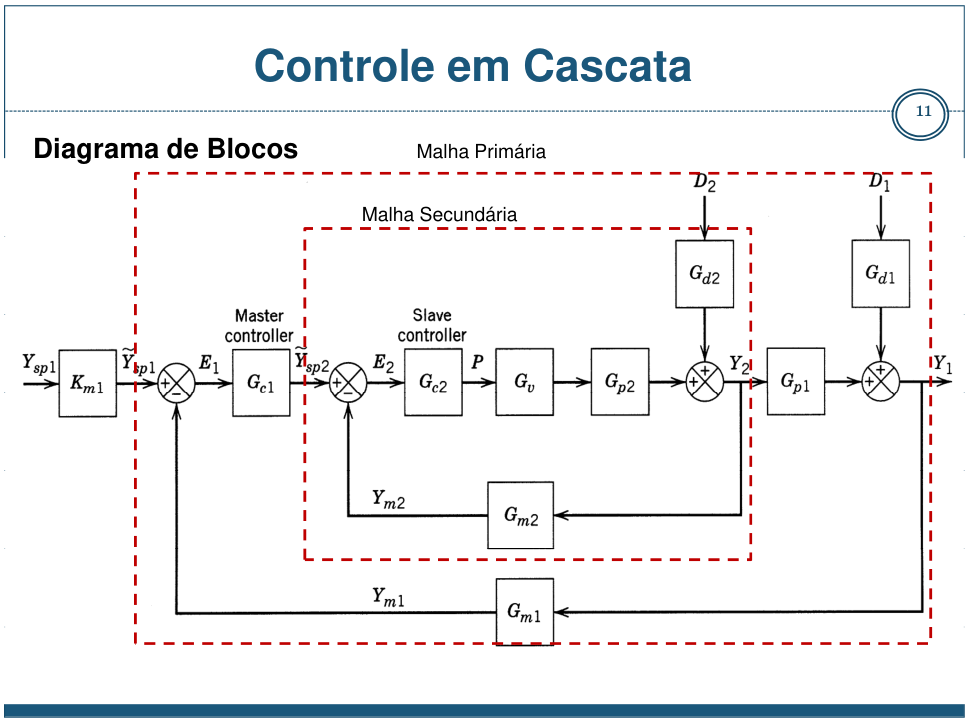

# Controle em cascata

**Uma medida a mais, duas malhas.** A variável intermediária permite reagir a uma mudança antes que ela chegue à saída principal.

[Abrir no Colab](https://colab.research.google.com/drive/1NXIlPniygCnQuvOYHTX7nrvKJKcmN1B3) · [Notebook no repositório](toolbox.ipynb)



O diagrama é um recorte do slide 11 do material de Controle em Cascata da UFF, indicado nos materiais de apoio. Ele ilustra a arquitetura; os parâmetros do notebook vêm do artigo abaixo.

## O que muda nesta estratégia

Na malha simples, um controlador acompanha a saída principal `y` e envia o comando ao atuador. Na cascata, o PI externo acompanha `y`, mas sua saída é a referência da variável intermediária `x`. O PI interno acompanha `x` e envia o comando ao mesmo atuador.

A vantagem aparece quando uma perturbação afeta primeiro `x` e a malha interna consegue corrigi-la depressa. Por isso, o painel permite mudar o local da perturbação: **entre as etapas** ou **na saída principal**. É uma comparação que ajuda a escolher a estratégia, não apenas a contar controladores.

## Quando aplicar

A medida intermediária deve ter relação com a saída principal, perceber uma perturbação relevante e responder mais rapidamente. Temperatura/vazão e nível/vazão são combinações frequentes, mas é preciso verificar essas condições em cada processo. Sintoniza-se e fecha-se primeiro a malha interna; a externa considera essa malha já fechada.

## O artigo e os modelos

FRANKLIN, Taniel S.; SANTOS, Tito L. M.; ARAÚJO, José Mário. **Critério de estabilidade simplificado para sistemas lineares em cascata com atraso variável: uma abordagem via preditor de Smith Filtrado**. Congresso Brasileiro de Automática, 2020. Autores vinculados ao SENAI CIMATEC, à UFBA e ao IFBA. [Artigo e PDF](https://ojs.sba.org.br/index.php/cba/article/view/1258). [DOI](https://doi.org/10.48011/asba.v2i1.1258).

As equações 20–21 do estudo de caso, página 6, fornecem:

```math
G_2(s)=\frac{3e^{-3s}}{13{,}3s+1},\qquad
G_1(s)=\frac{10(1-5s)e^{-5s}}{(30s+1)^3(10s+1)^2}.
```

`G₂` é a etapa rápida e `G₁` é a lenta. O zero no semiplano direito em `G₁` produz resposta inversa: uma pequena reação inicial no sentido contrário faz parte do modelo. Os sinais são desvios normalizados em unidades arbitrárias (u.a.); o tempo está em segundos. O artigo apresenta um caso numérico, não uma bancada física identificada nessas unidades.

## Identificação e validação

Aplicar um degrau de 0,2 u.a. à etapa rápida e adicionar ruído gaussiano de desvio-padrão 0,015 u.a. Os dados são **simulados a partir do modelo publicado**, não medições experimentais do artigo. Separar aquisição, identificação e projeto do controlador: primeiro observar a resposta da planta; depois usar somente os dados do ensaio para estimar o modelo.

Salvar três ensaios separados como CSV em `dados_ensaio/`, com colunas `tempo`, `entrada` e `saida`. Entrada e saída são desvios em relação ao ponto de operação; manter as unidades do canal e do tempo. Os arquivos são `ajuste_<canal>.csv`, `escolha_<canal>.csv` e `validacao_<canal>.csv`; nesta estratégia, o canal é `rapida`.

| Modelo candidato | Estrutura | Parâmetros livres |
|---|---|---:|
| P1D | Um polo real e atraso | 3: ganho, uma constante de tempo e atraso |
| P2D | Dois polos reais e atraso | 4: ganho, duas constantes de tempo e atraso |
| P3D | Três polos reais e atraso | 5: ganho, três constantes de tempo e atraso |

```math
\widehat G_n(s)=\frac{K e^{-\theta s}}{\prod_{i=1}^{n}(\tau_i s+1)},\qquad n=1,2,3.
```

1. **Ajustar:** estimar cada candidato por mínimos quadrados no primeiro ensaio. As constantes de tempo são positivas, garantindo polos reais estáveis; o atraso é estimado e fica não negativo. Os parâmetros publicados geram a planta, mas não são impostos ao ajuste.
2. **Escolher com parcimônia:** prever o segundo ensaio sem reajustar. Selecionar o modelo de menor ordem cujo FIT fique até **1 ponto percentual abaixo do melhor FIT**. Mais parâmetros só se justificam quando a melhora de previsão superar essa tolerância.
3. **Validar:** usar o terceiro ensaio apenas para avaliar o modelo escolhido, com entrada e ruído diferentes. Não reajustar parâmetros nem selecionar novamente com esses dados.

```math
FIT=100\left(1-\frac{\|y-\widehat y\|_2}{\|y-\overline y\|_2}\right),\qquad
RMSE=\sqrt{\frac{1}{N}\sum_{k=1}^{N}(y_k-\widehat y_k)^2}.
```

O FIT compara o erro com a variação medida: pode ser negativo e não significa probabilidade de acerto. O RMSE conserva a unidade da saída. Ambos dependem do ensaio e do ruído; uma curva próxima dos pontos de ajuste, sozinha, não comprova qualidade de previsão.

**Antes do PI-IMC, explicitar a redução:** manter o ganho e o atraso do candidato escolhido e usar `τeq = soma(τi)`.

```math
\tau_{eq}=\sum_{i=1}^{n}\tau_i,\qquad
\widehat G_{eq}(s)=\frac{K e^{-\theta s}}{\tau_{eq}s+1}.
```

Essa aproximação preserva o ganho estático e o primeiro momento, mas não toda a dinâmica de P2D/P3D. A planta publicada permanece na simulação. O experimento de comparação usa a mesma planta e o mesmo tempo IMC para os PIs derivados dos três candidatos; o painel principal usa a seleção automática por parcimônia.

## Sintonia IMC

Para a aproximação de primeira ordem com atraso, calcular:

```math
K_c=\frac{\tau_{eq}}{K(\tau_c+\theta)},\qquad T_i=\tau_{eq},
\qquad C(s)=K_c\left(1+\frac{1}{T_i s}\right).
```

O tempo IMC `τc` regula a rapidez desejada: um valor maior torna a ação mais lenta. O PI interno usa o ganho, o atraso estimado e `τeq` do candidato escolhido. Comparar também as sintonias de P1D/P2D/P3D, mantendo planta e `τc` iguais, para observar o efeito da identificação sem trocar simultaneamente a exigência de resposta.

O PI externo usa uma aproximação da etapa lenta em série com a malha interna fechada. A simulação conserva as funções de transferência completas. A etapa lenta sem atraso tem primeiro momento de 115 s: 110 s dos polos e 5 s do zero. Para a malha simples, manter `K=30`, `τ=128,3 s` e `θ=8 s`.

Para o PI interno com tempo integral `Ti` e ganho proporcional `Kc`, o primeiro momento da malha interna fechada é:

```math
m_2=\frac{T_i}{3K_c}.
```

O fator 3 é o ganho da etapa rápida publicada. Essa expressão continua válida quando o atraso do modelo identificado é livre; não substituir o atraso estimado por 3 s no cálculo do PI. A aproximação externa usa `K=10`, `τ=112+m₂` e `θ=8 s`, com tempo IMC externo de 120 s. É uma redução por momentos para esta toolbox, não uma identificação da planta externa.

## O que experimentar

1. Execute as células em ordem e veja primeiro a estimação e a validação.
2. No painel, mantenha a perturbação **entre as etapas** e o IMC interno em 10 s. Compare `x` e depois `y`.
3. Aumente o IMC interno até 60 s. A malha interna perde rapidez; observe se a vantagem continua.
4. Mude a perturbação para **na saída principal**. Ela não passa primeiro pela medida interna.
5. Mude a amplitude. Como o caso é linear, as respostas escalam com ela; a planta e os controladores continuam os mesmos.

O erro acumulado exibido é a integral do módulo do desvio de `y`, em u.a.·s. Um valor menor representa menor afastamento acumulado nesse ensaio. Os gráficos atualizam ao soltar o controle deslizante.

## Bibliotecas

| Pacote | Uso no notebook |
|---|---|
| python-control | Funções de transferência, associação em série, realimentação, atraso por Padé e respostas temporais |
| NumPy | Entradas, ruído, vetores de tempo e integral numérica |
| SciPy | Ajuste de P1D/P2D/P3D por `least_squares` e leitura dos ensaios CSV |
| Matplotlib | Gráficos de identificação, validação e comparação |
| ipywidgets | Escolha do local da perturbação, amplitude e tempo IMC |

## Materiais de apoio

- [Controle em Cascata — Ninoska Bojorge, UFF](https://www.professores.uff.br/ninoska/wp-content/uploads/sites/57/2017/11/Aula-25-Controle-Cascata2017_2sem17.pdf): diagramas, condições de aplicação e exemplos de processos.
- [Controlador PID — Parte I, LASC/UFSC](https://www.youtube.com/watch?v=KW4IGc9pgR0) e [Parte II](https://www.youtube.com/watch?v=MZpidTSxtKI): revisão dos controladores utilizados. A [página oficial do curso](https://lasc.ufsc.br/curso-de-sistemas-de-controle/) reúne as videoaulas; elas revisam PID, não são aulas específicas de cascata.
- [Arquivos originais fornecidos](materiais_aula/): modelos e códigos preservados como material de consulta, com os créditos originais.

## Limites e adaptações

O artigo investiga um preditor de Smith filtrado e atrasos variáveis. A toolbox utiliza seus modelos para estudar **cascata clássica com PIs por IMC e atrasos fixos**. Não se reproduzem o controlador nem o resultado de estabilidade do artigo. Os atrasos são aproximados por Padé de ordem 3 para a álgebra das malhas; não representam atraso variável de rede.

O caso é linear, sem limites do atuador, calibração de equipamento ou balanço de massa/energia. A cascata pode perder vantagem quando a malha interna fica lenta ou a perturbação chega diretamente à saída. Para uma aplicação real, é necessário identificar o processo na faixa de operação e incluir suas restrições.


Referência da correlação PI utilizada: [APMonitor/BYU — Proportional Integral Control, seção IMC FOPDT Tuning Correlations](https://www.apmonitor.com/pdc/index.php/Main/ProportionalIntegralControl). O artigo brasileiro acima fornece a planta; esta fonte explicita a regra IMC de primeira ordem com atraso.

Referências da identificação: [estruturas de modelos de processo — MathWorks](https://www.mathworks.com/help/ident/ref/idproc.html), [definição de FIT](https://www.mathworks.com/help/ident/ref/compare.html) e [validação de modelos](https://www.mathworks.com/help/ident/ug/validating-models-after-estimation.html). O código Python realiza o ajuste por mínimos quadrados; não utiliza MATLAB.

Para usar ensaios próprios, definir `usar_ensaio_externo=True`. Fornecer os três CSVs por canal em desvios do ponto de operação, começando em equilíbrio com entrada zero, na unidade de tempo e nas escalas desta planta. A família implementada é restrita a ganhos positivos e polos reais estáveis. O ajuste assume entrada mantida entre amostras; atrasos fracionários usam interpolação. Dados com outras dinâmicas exigem outras estruturas e revisão da sintonia.
