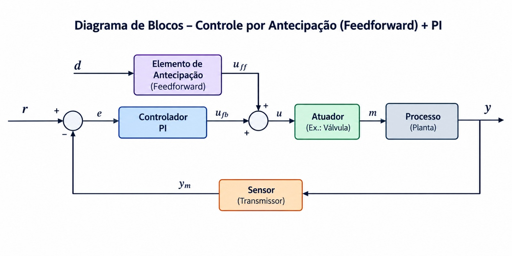
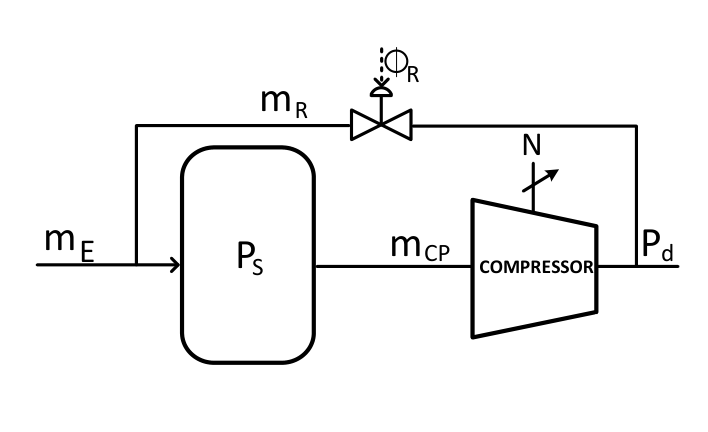

# Controle por antecipação (feedforward)

[Abrir no Colab](https://colab.research.google.com/drive/132PqVwWt00uGhxk0T4wMzUwh8kETtNNf)

## Teoria

Medir a perturbação e calcular uma ação de compensação antes de surgir erro na saída. O PI corrige o erro restante. Aplicar quando a perturbação puder ser medida a tempo e seu efeito no processo for conhecido.



Diagrama gerado por IA. A perturbação também atua no processo pelo canal `Gd`.

```math
F(s)=-\frac{G_d(s)}{G_u(s)},\qquad u=u_{PI}+F(s)d_{medido}.
```

O sinal negativo compensa o efeito da perturbação. Atraso de medição e erro de modelo reduzem a eficácia da antecipação.

## Modelo



Modelo de [1], eqs. 18–19; imagem: Fig. 2, p. 2.

```math
G_d(s)=\frac{0{,}3092s+0{,}08813}{s^2+0{,}672s+0{,}1764},\qquad
G_u(s)=\frac{0{,}3211s+0{,}1927}{s^2+0{,}6s+0{,}16}.
```

`Gu`: ação da válvula; `Gd`: efeito da alimentação. Sinais em desvios normalizados; tempo em unidades do modelo (u.t.). A conversão desses canais para unidades físicas não está especificada. A simulação representa o modelo linear local do compressor.

## Identificação e IMC

Identificar o canal `acao` pelo [procedimento de identificação](../../README.md#identificação). Usar degrau de 0,2 e ruído de desvio-padrão 0,004. A planta possui zero e polos complexos; P1D/P2D/P3D de polos reais são aproximações.

```math
K_c=\frac{\tau_{eq}}{K(\lambda+\theta)},\qquad T_i=\tau_{eq},\qquad
C(s)=K_c\left(1+\frac{1}{T_i s}\right).
```

O PI usa o modelo identificado e λ = 4 u.t. O compensador `F` usa os dois canais publicados completos; neste caso, é próprio e estável.

Com `S=1/(1+Gu C)`, a resposta é:

```math
y=S G_{d,real}d+S G_u F d_{medido}.
```

Com informação instantânea e modelos exatos, `Gd + Gu F = 0`.

## Experimento

- Comparar PI e PI + antecipação com queda de alimentação de 0,2.
- Aumentar o atraso de medição e observar quando a compensação começa.
- Alterar o efeito real da alimentação; 1,3 corresponde a um ganho 30% maior.

O gráfico inferior mostra a variação de comando. O painel inclui ruído de medição; a válvula não possui saturação neste modelo.

## Bibliotecas

`control`: funções de transferência e realimentação; `NumPy`: sinais e ruído; `SciPy`: identificação; `Matplotlib`: gráficos; `ipywidgets`: painéis.

## Materiais de apoio

- [Controle antecipatório — UFF](https://www.professores.uff.br/ninoska/wp-content/uploads/sites/57/2017/08/Aula_24_Controle_FForward_1sem2015.pdf).
- [Controle de processos — IFC](https://professor.luzerna.ifc.edu.br/ricardo-kerschbaumer/wp-content/uploads/sites/43/2020/12/Aula-8-Controle-de-processos.pdf).
- [PID I](https://www.youtube.com/watch?v=KW4IGc9pgR0) e [PID II](https://www.youtube.com/watch?v=MZpidTSxtKI) — [LASC/UFSC](https://lasc.ufsc.br/curso-de-sistemas-de-controle/).
- [MATLAB e Simulink](materiais_aula/).

## Referências

1. Yang, B. B. P.; Mendes, P. R.; Normey-Rico, J. E.; Branco, A. F.; Vettorazzo, C. (2018). *Controle regulatório PI+FeedForward antisurge aplicado a compressores para plataformas de produção de petróleo e gás*. CBA. [Artigo](https://ojs.sba.org.br/index.php/cba/article/view/812). Modelos: eqs. 18–19; imagem: Fig. 2.
2. [Referências de identificação e IMC](../../README.md#referências).
