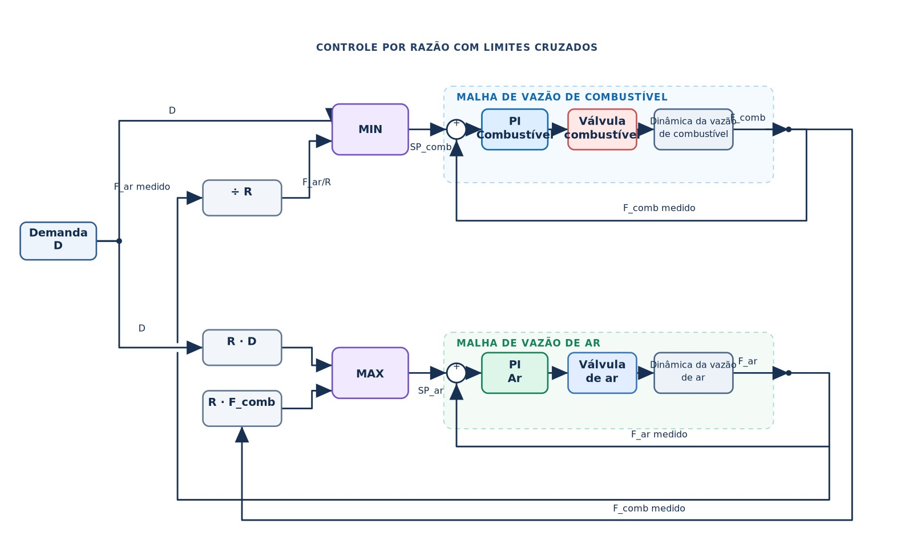
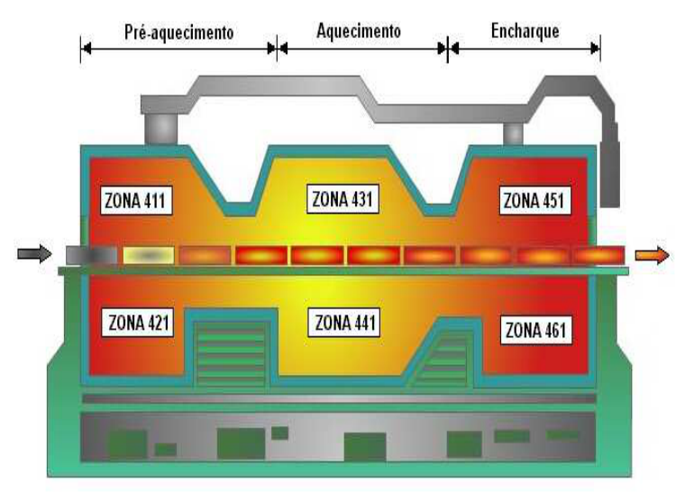

# Razão e limites cruzados

[Abrir no Colab](https://colab.research.google.com/drive/1e6rVoVLpmtAASvUmJ_kE-cIBIlpE6GFa)

## Teoria

O controle por razão mantém uma proporção entre duas vazões. Os limites cruzados acrescentam uma ordem de atuação: aumentar o ar antes do combustível e reduzir o combustível antes do ar.



Diagrama gerado por IA.

Para demanda de combustível $D$, razão desejada $R$ e vazões medidas $Q_g$ e $Q_a$:

```math
r_g=\min(D,Q_a/R),\qquad r_a=\max(RD,RQ_g).
```

Cada PI usa o erro entre sua referência e a vazão medida. Na subida, o combustível depende do ar disponível; na descida, o ar acompanha o combustível ainda presente. O seletor modifica referências: a vazão responde conforme a dinâmica da planta e do controlador.

Aplicar quando duas correntes precisam atuar de forma coordenada e o desequilíbrio em uma direção é mais indesejável. As escalas das medições devem ser compatíveis com a razão definida.

## Modelo



Fonte: Teixeira, Jota e Teixeira (2007), Figura 2, p. 71.

Utilizar as malhas de gás GFIC441 e ar AFIC441 da mesma zona do forno, com os modelos médios de subida de 2004, Tabela 2, pp. 73–74:

| Canal | K ((mil Nm³/h)/ponto percentual) | τ (s) | θ (s) |
|---|---:|---:|---:|
| Gás | 0,25 | 4,78 | 1 |
| Ar | 0,51 | 7,16 | 2 |

```math
\Delta Q(s)=\frac{K e^{-\theta s}}{\tau s+1}\Delta m(s).
```

Os canais descrevem variações de vazão para variações de abertura. No painel, normalizar cada canal pelo seu ganho estático. A razão entre esses fluxos normalizados serve para comparar a coordenação das malhas; não corresponde a uma razão estequiométrica de combustão.

## Identificação e IMC

Identificar os canais `gas` e `ar` separadamente, com ensaios simulados e ruído. Seguir as etapas de [identificação](../../README.md#identificação): ajuste, escolha com parcimônia e validação independente.

Reduzir o modelo escolhido por $\tau_{eq}=\sum_i\tau_i$ e calcular:

```math
K_c=\frac{\tau_{eq}}{K(\lambda+\theta)},\qquad T_i=\tau_{eq},\qquad \lambda=8\ \mathrm{s}.
```

Na escala normalizada, usar o ganho estimado dividido pelo ganho publicado. Os dois casos comparados mantêm os mesmos PIs. O comando fica entre 0 e 1, com interrupção da integração quando ela amplia a saturação.

## Experimentos

1. Explorar os seletores MIN e MAX antes de fechar as malhas.
2. Alterar demanda e razão-alvo; comparar referências simultâneas com limites cruzados.
3. Aumentar o ruído e observar a razão transitória e a sequência das vazões.

O exemplo utiliza limite cruzado simples. O artigo apresenta uma arquitetura industrial com duplo limite cruzado. Atrasos, saturação e ruído podem produzir desvios transitórios da razão.

**Bibliotecas:** NumPy, SciPy, Matplotlib, ipywidgets e IPython.

## Referências e apoio

- Teixeira, B. O. S.; Jota, F. G.; Teixeira, M. H. **Modelagem, controle e otimização do processo dos fornos de reaquecimento de placas**. *SBA: Controle & Automação*, 18(1), 67–93, 2007. [Artigo](https://doi.org/10.1590/S0103-17592007000100006).
- [IMC e identificação](../../README.md#referências).
- [Controle de um sistema de mistura — UnB](https://www.ene.unb.br/estognetti/files/controle_razao_tca_2012_2.pdf).
- [Sistemas de Controle — LASC/UFSC](https://lasc.ufsc.br/curso-de-sistemas-de-controle/) · [PID I](https://www.youtube.com/watch?v=KW4IGc9pgR0).
- [Materiais de aula](materiais_aula/).
