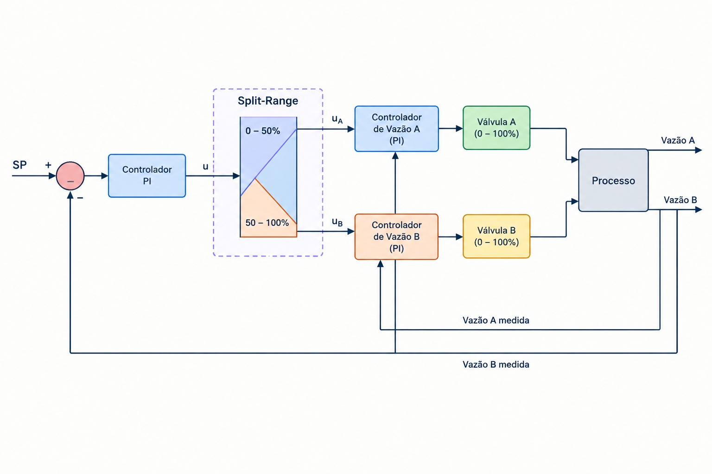

# Faixa dividida (split-range)

[Abrir no Colab](https://colab.research.google.com/drive/172l9HdNCzOoUF0heMQLK04Rvqr6JDvvt)

## Teoria

O controle em faixa dividida distribui o comando de um controlador entre dois ou mais recursos. Cada recurso atua numa faixa definida do comando, permitindo complementar capacidade ou estabelecer uma ordem de utilização.



Diagrama gerado por IA. A figura inclui malhas locais de vazão e divisão 50/50; o exemplo usa um PI, divisor estático e ponto de divisão calculado.

Neste caso, a água quente atua primeiro. O aquecedor elétrico começa a atuar após a água atingir seu comando máximo. Para comando $v$ entre 0 e 1 e ponto de divisão $p$:

```math
u_{agua}=\operatorname{clip}(v/p,0,1),\qquad
u_{eletrico}=\operatorname{clip}((v-p)/(1-p),0,1).
```

Usar a estratégia quando um recurso não cobre toda a faixa de operação ou quando há uma prioridade de utilização. Dinâmicas diferentes exigem uma sintonia que funcione nas duas faixas.

## Modelo


Fonte: Luna et al. (2024), Figura 1, p. 1249.

Utilizar os dois canais de aquecimento da Tabela 1, p. 1252:

| Canal | K (°C/unidade de comando) | τ (min) | θ (min) |
|---|---:|---:|---:|
| Água quente | 12 | 10 | 3 |
| Aquecedor elétrico | 8 | 5 | 1 |

```math
G_{agua}(s)=\frac{12e^{-3s}}{10s+1},\qquad
G_{eletrico}(s)=\frac{8e^{-s}}{5s+1}.
```

Com temperatura externa constante em 17 °C:

```math
T(t)=17+\Delta T_{agua}(t)+\Delta T_{eletrico}(t).
```

Os comandos individuais variam entre 0 e 1. Nesse modelo, água quente sozinha alcança 29 °C; os dois recursos alcançam 37 °C. O artigo trata de split-range generalizado e MPC; aqui aplicar o divisor clássico aos canais publicados.

## Identificação e IMC

Identificar os canais `agua` e `eletrico` separadamente, com ensaios simulados e ruído. Seguir as etapas de [identificação](../../README.md#identificação).

Calcular o ponto de divisão pelos ganhos estimados:

```math
p=\frac{\widehat K_{agua}}{\widehat K_{agua}+\widehat K_{eletrico}}.
```

Essa escolha iguala as inclinações estacionárias das duas faixas. O valor nominal é 0,60. Para cada canal, usar $\tau_{eq,i}=\sum_j\tau_{ij}$. Adotar o modelo aproximado de projeto:

```math
K_p=\widehat K_{agua}+\widehat K_{eletrico},\qquad
\tau_p=\max_i\tau_{eq,i},\qquad \theta_p=\max_i\widehat\theta_i.
```

```math
K_c=\frac{\tau_p}{K_p(\lambda+\theta_p)},\qquad T_i=\tau_p,\qquad
\lambda=12\ \mathrm{min}.
```

Um único PI atende às duas faixas. O modelo de projeto é uma aproximação; igualar os ganhos não iguala atrasos ou constantes de tempo. Interromper a integração quando ela amplia a saturação.

## Experimentos

1. Alterar o comando manual entre 40%, 60% e 80%; observar os recursos ativos.
2. Comparar referências de 25 °C e 33 °C com água quente sozinha e com os dois recursos.
3. Alterar o tempo IMC e observar a rapidez da temperatura e dos comandos.
4. Pedir 39 °C e observar a saturação: a referência supera a capacidade disponível.

**Bibliotecas:** NumPy, SciPy, Matplotlib, ipywidgets e IPython.

## Referências e apoio

- Luna, J. D. F. O. et al. **A model predictive control interpretation of the generalized split-range control**. CBA, 1249–1254, 2024. [Artigo](https://doi.org/10.20906/CBA2024/4340).
- [IMC e identificação](../../README.md#referências).
- [Estratégias de controle — UnB](https://www.ene.unb.br/estognetti/files/labcprocess/Apoio7_LCP_estrategias.pdf), slides 9–12.
- [Sistemas de Controle — LASC/UFSC](https://lasc.ufsc.br/curso-de-sistemas-de-controle/) · [PID I](https://www.youtube.com/watch?v=KW4IGc9pgR0).
- [Materiais de aula](materiais_aula/).
