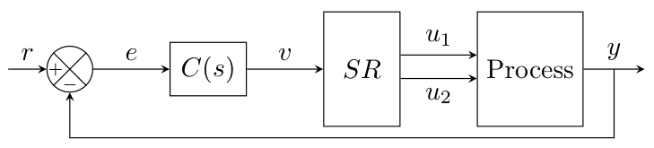

# Faixa dividida · split-range

[Abrir no Colab](https://colab.research.google.com/drive/172l9HdNCzOoUF0heMQLK04Rvqr6JDvvt) · [Notebook no repositório](toolbox.ipynb)

**O ponto principal:** um único comando pode acionar recursos diferentes, numa ordem definida. Aqui a água quente entra primeiro; o aquecedor elétrico complementa a capacidade quando necessário.

## Usar a toolbox

Abra [toolbox.ipynb](toolbox.ipynb) no Colab e execute as células na sequência. Primeiro, mova um comando manual para entender o divisor. Depois, estime e valide os modelos. Por fim, compare água quente sozinha com faixa dividida.

| Controle | O que muda | Experimento sugerido |
|---|---|---|
| Comando manual | Abertura dos dois recursos antes de fechar a malha | 40%, 60% e 80%: veja quem atua |
| Referência | Temperatura desejada | Compare 25 °C e 33 °C |
| IMC λ | Velocidade desejada da resposta | Compare 8 e 24 min com a mesma referência |

O gráfico final mostra a temperatura e a abertura de cada recurso. Peça também 39 °C: o pedido ultrapassa a capacidade dos dois recursos, e a temperatura não chega à referência.

## O processo e o artigo



O modelo vem de um artigo brasileiro do CBA 2024, de autores do IFRO e da UFSC [1]. Ele apresenta um ambiente com dois recursos de resfriamento e dois de aquecimento. O recorte didático aqui mantém **somente os canais de aquecimento**, com temperatura externa constante em 17 °C.

| Canal | K (°C por unidade de comando) | τ (min) | θ (min) | Comando |
|---|---:|---:|---:|---|
| Água quente | 12 | 10 | 3 | 0–1 |
| Aquecedor elétrico | 8 | 5 | 1 | 0–1 |

Os números são da Tabela 1, p. 1252, de [1], transcritos como publicados:

```math
G_{agua}(s)=\frac{12e^{-3s}}{10s+1},\qquad
G_{eletrico}(s)=\frac{8e^{-s}}{5s+1}.
```

Para a temperatura externa constante e o sistema inicialmente em equilíbrio:

```math
T(t)=17+\Delta T_{agua}(t)+\Delta T_{eletrico}(t).
```

A água quente sozinha pode fornecer até 12 °C de aumento, portanto a faixa estacionária desta realização é 17–29 °C. Os dois canais fornecem até 20 °C de aumento, alcançando 37 °C. Esses limites são consequências do modelo linear e dos comandos 0–1; não são limites universais de equipamentos reais.

O artigo [1] investiga **split-range generalizado e MPC**. A toolbox usa seus modelos publicados para estudar o **split-range clássico**, com um só PI e um divisor estático. Não implementa MPC, otimização ou passagem de bastão. O artigo nacional [2] complementa a discussão das vantagens e limitações do divisor clássico.

## O divisor

Para comando único `v` entre 0 e 1 e ponto de divisão `p`:

```math
u_{agua}=\operatorname{clip}(v/p,0,1),\qquad
u_{eletrico}=\operatorname{clip}((v-p)/(1-p),0,1).
```

No teste manual, `p=0,60`, obtido por `12/(12+8)`. Na malha fechada, o divisor usa os **ganhos estimados**. O recurso prioritário fica saturado quando o segundo começa a atuar.

| Faixa do comando | Água quente | Aquecedor elétrico |
|---|---|---|
| 0 ≤ v ≤ p | Cresce de 0 a 1 | Fica em 0 |
| p < v ≤ 1 | Fica em 1 | Cresce de 0 a 1 |

Essa escolha iguala as inclinações estacionárias das duas faixas: `K_agua/p = K_eletrico/(1−p) = K_agua+K_eletrico`. Igualar o ganho estático **não** torna iguais os atrasos ou constantes de tempo. Priorizar a água quente é uma escolha qualitativa de uso; o notebook não estima preços nem promete economia monetária.

## Identificação e validação

Excitar cada recurso separadamente com um degrau de comando de 0,25 e adicionar ruído gaussiano de desvio-padrão 0,08 °C. Os ensaios são **simulados com os canais publicados**, sem usar os registros experimentais dos autores. Identificar água quente e aquecedor elétrico separadamente antes de projetar o divisor e o PI comum.

Salvar três ensaios separados como CSV em `dados_ensaio/`, com colunas `tempo`, `entrada` e `saida`. Entrada e saída são desvios em relação ao ponto de operação; manter as unidades do canal e do tempo. Os arquivos são `ajuste_<canal>.csv`, `escolha_<canal>.csv` e `validacao_<canal>.csv`; nesta estratégia, os canais são `agua`, `eletrico`.

| Modelo candidato | Estrutura | Parâmetros livres |
|---|---|---:|
| P1D | Um polo real e atraso | 3: ganho, uma constante de tempo e atraso |
| P2D | Dois polos reais e atraso | 4: ganho, duas constantes de tempo e atraso |
| P3D | Três polos reais e atraso | 5: ganho, três constantes de tempo e atraso |

```math
\hat{G}_n(s)=\frac{K e^{-\theta s}}{\prod_{i=1}^{n}(\tau_i s+1)},\qquad n=1,2,3.
```

1. **Ajustar:** estimar cada candidato por mínimos quadrados no primeiro ensaio. As constantes de tempo são positivas, garantindo polos reais estáveis; o atraso é estimado e fica não negativo. Os parâmetros publicados geram a planta, mas não são impostos ao ajuste.
2. **Escolher com parcimônia:** prever o segundo ensaio sem reajustar. Selecionar o modelo de menor ordem cujo FIT fique até **1 ponto percentual abaixo do melhor FIT**. Mais parâmetros só se justificam quando a melhora de previsão superar essa tolerância.
3. **Validar:** usar o terceiro ensaio apenas para avaliar o modelo escolhido, com entrada e ruído diferentes. Não reajustar parâmetros nem selecionar novamente com esses dados.

```math
FIT=100\left(1-\frac{\|y-\hat{y}\|_2}{\|y-\overline y\|_2}\right),\qquad
RMSE=\sqrt{\frac{1}{N}\sum_{k=1}^{N}(y_k-\hat{y}_k)^2}.
```

O FIT compara o erro com a variação medida: pode ser negativo e não significa probabilidade de acerto. O RMSE conserva a unidade da saída. Ambos dependem do ensaio e do ruído; uma curva próxima dos pontos de ajuste, sozinha, não comprova qualidade de previsão.

**Antes do PI-IMC, explicitar a redução:** manter o ganho e o atraso do candidato escolhido e usar `τeq = soma(τi)`.

```math
\tau_{eq}=\sum_{i=1}^{n}\tau_i,\qquad
\hat{G}_{eq}(s)=\frac{K e^{-\theta s}}{\tau_{eq}s+1}.
```

Essa aproximação preserva o ganho estático e o primeiro momento, mas não toda a dinâmica de P2D/P3D. A planta publicada permanece na simulação. O experimento de comparação usa a mesma planta e o mesmo tempo IMC para os PIs derivados dos três candidatos; o painel principal usa a seleção automática por parcimônia.

## Sintonia IMC

O ponto de divisão usa os ganhos dos candidatos selecionados:

```math
p=\frac{\widehat K_{agua}}{\widehat K_{agua}+\widehat K_{eletrico}}.
```

Antes da sintonia, reduzir cada canal por `τeq,i = soma(τi)`. Para um PI comum às duas faixas, adotar o seguinte modelo **aproximado de projeto**:

```math
K_p=\widehat K_{agua}+\widehat K_{eletrico},\qquad
\tau_p=\max_i\tau_{eq,i},\qquad \theta_p=\max_i\widehat\theta_i.
```

Aplicar IMC:

```math
K_c=\frac{\tau_p}{K_p(\lambda+\theta_p)},\qquad T_i=\tau_p.
```

O padrão é `λ=12 min`. Valores maiores tornam a ação mais gradual. Usar a maior constante equivalente e o maior atraso é um compromisso didático para os dois canais, **não uma equivalência exata nem uma prova de estabilidade para qualquer divisão**. Comparar as sintonias derivadas de P1D/P2D/P3D mantendo a mesma planta e o mesmo tempo IMC; a comparação não altera a seleção automática usada no painel principal.

O caso “só água” mantém o mesmo PI e limita o comando único a `p`, para comparar a disponibilidade de recurso sem trocar também a sintonia. Isso corresponde à faixa do divisor em que a água abre de 0 a 100%. O motor limita as entradas, interrompe a acumulação integral quando ela empurra contra um limite e atualiza os dois canais publicados de primeira ordem com atraso em passo de 0,05 min. Os atrasos usam filas de amostras e a parte de primeira ordem usa a solução exata para entrada constante em cada intervalo.

## Quando usar e onde ter cuidado

Faixa dividida é útil quando um único recurso não cobre toda a faixa de operação ou quando existe uma ordem desejada de utilização. Um exemplo é priorizar um recurso e complementar com outro após a saturação. Em outras aplicações, os recursos podem ter efeitos opostos, como aquecer e resfriar; isso exige outro mapeamento, com sinais e ponto de transição próprios.

O divisor precisa considerar os ganhos e limites físicos. Recursos com dinâmicas muito diferentes podem exigir uma sintonia de compromisso insatisfatória. Alternativas com controladores separados são discutidas em [1] e [2]. O notebook omite não linearidades, perdas variáveis, válvulas reais, banda morta e mudanças de temperatura externa para deixar a ideia principal visível.

## Bibliotecas

| Biblioteca | Uso |
|---|---|
| NumPy | Dados, ruído, saturação e atualização dos modelos |
| SciPy (`least_squares`) | Ajuste e comparação dos três candidatos de cada canal |
| Matplotlib | Aberturas, validação e resposta de temperatura |
| ipywidgets | Controles simples para os experimentos |
| IPython | Exibição dos painéis |

Não há componentes JavaScript personalizados nem conexão com equipamentos. As bibliotecas estão disponíveis no Colab.

## Materiais de apoio

- [Curso de Sistemas de Controle — LASC/UFSC](https://lasc.ufsc.br/curso-de-sistemas-de-controle/): notas e videoaulas de revisão.
- [Controladores PID I — LASC/UFSC](https://www.youtube.com/watch?v=KW4IGc9pgR0) e [PID II](https://www.youtube.com/watch?v=MZpidTSxtKI): revisão do PI usado antes do divisor; não tratam especificamente desta estratégia.
- [Estratégias de controle — UnB](https://www.ene.unb.br/estognetti/files/labcprocess/Apoio7_LCP_estrategias.pdf): seção de split-range, slides 9–12, com exemplos de recursos opostos.
- [Materiais de aula](materiais_aula/): arquivo original de estratégias para consulta, com autoria e origem nas referências dessa pasta. O material fornecido não contém um script específico de faixa dividida. Não é necessário para executar o notebook.

## Referências

1. **Luna, J. D. F. O.; Pedrisch, R. O.; Silva, J. V. B.; Ferreira Júnior, J. S. G.; Guimarães, C. H. A.; Alves, K. D.; Normey-Rico, J. E.** A model predictive control interpretation of the generalized split-range control. *XXV Congresso Brasileiro de Automática*, 1249–1254, 2024. Autores vinculados ao IFRO e à UFSC. [Página do artigo](https://ojs.sba.org.br/index.php/cba/article/view/4340), [DOI](https://doi.org/10.20906/CBA2024/4340), [PDF](https://ojs.sba.org.br/index.php/cba/article/download/4340/3824). Modelos: seção 4 e Tabela 1. Imagem: recorte original da Figura 1, p. 1249. O benchmark foi retomado de Reyes-Lúa e Skogestad (2020), conforme declarado no próprio artigo.
2. **Longhi, L. G. S.** Uma heurística fundamental — e normalmente esquecida — para o projeto de sistemas de controle: justificativa e exemplos industriais. *Revista Técnica da Universidade Petrobras*, 1(4), 36–75, 2017. [Artigo](https://rtup.petrobras.com.br/rtup/article/download/34/40/64). Discussão conceitual das estruturas e das limitações do split-range; não fornece os parâmetros numéricos desta simulação.
3. **Rivera, D. E.; Morari, M.; Skogestad, S.** Internal model control. 4. PID controller design. *Industrial & Engineering Chemistry Process Design and Development*, 25(1), 252–265, 1986. [DOI](https://doi.org/10.1021/i200032a041).
4. **Stockler, E. — UnB.** Controle Seletivo, Split-Range, Gain-Scheduled e Inferencial. Material de Controle de Processos, 2015. [PDF](https://www.ene.unb.br/estognetti/files/labcprocess/Apoio7_LCP_estrategias.pdf).
5. **LASC — UFSC.** Curso de Sistemas de Controle; videoaulas Controladores PID I e II. [Página institucional](https://lasc.ufsc.br/curso-de-sistemas-de-controle/).

Parâmetros de planta de [1]; divisor clássico, ensaios ruidosos e sintonia IMC implementados para esta toolbox.


Referência da correlação PI utilizada: [APMonitor/BYU — Proportional Integral Control, seção IMC FOPDT Tuning Correlations](https://www.apmonitor.com/pdc/index.php/Main/ProportionalIntegralControl). O artigo brasileiro acima fornece a planta; esta fonte explicita a regra IMC de primeira ordem com atraso.

Referências da identificação: [estruturas de modelos de processo — MathWorks](https://www.mathworks.com/help/ident/ref/idproc.html), [definição de FIT](https://www.mathworks.com/help/ident/ref/compare.html) e [validação de modelos](https://www.mathworks.com/help/ident/ug/validating-models-after-estimation.html). O código Python realiza o ajuste por mínimos quadrados; não utiliza MATLAB.

Para usar ensaios próprios, definir `usar_ensaio_externo=True`. Fornecer os três CSVs por canal em desvios do ponto de operação, começando em equilíbrio com entrada zero, na unidade de tempo e nas escalas desta planta. A família implementada é restrita a ganhos positivos e polos reais estáveis. O ajuste assume entrada mantida entre amostras; atrasos fracionários usam interpolação. Dados com outras dinâmicas exigem outras estruturas e revisão da sintonia.
