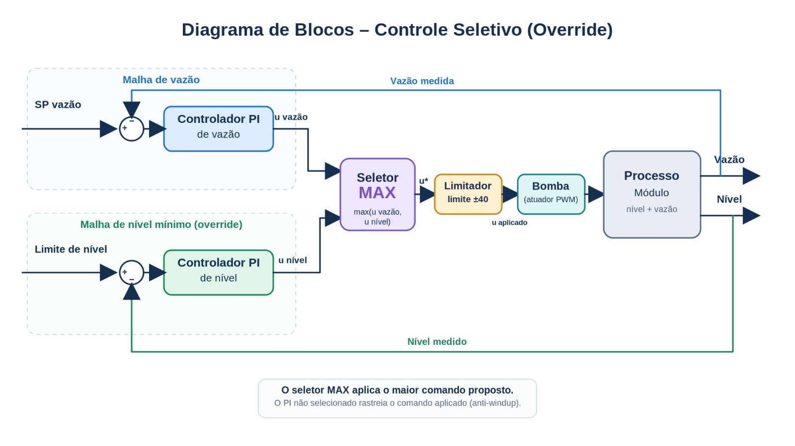

# Controle seletivo (override)

[Abrir no Colab](https://colab.research.google.com/drive/1vM2Ly36GAoXYpaAFQt31-j3gfqcSdEv6)

## Teoria

O controle seletivo permite que vários controladores disputem o mesmo atuador. Um seletor aplica o comando de maior ou menor valor, conforme o sentido da ação e a restrição que recebe prioridade.



Diagrama gerado por IA.

Neste processo, a bomba controla a vazão de retorno e influencia o nível do reservatório de sucção. Aumentar seu comando aumenta ambas as variáveis. O PI de vazão atende à referência habitual; o PI de nível assume quando é necessário elevar o nível:

```math
u=\max(u_{vazao},u_{nivel}).
```

O controlador não selecionado rastreia o comando aplicado. Esse rastreamento evita acumulação integral incompatível com o atuador e facilita a troca de prioridade. A seleção MAX depende do ganho positivo dos canais; outra configuração física pode exigir MIN.

## Modelo


Fonte: Silva e Jesus (2019), Figura 2, p. 3.

Utilizar as funções de transferência da Tabela 2, p. 4:

```math
G_h(s)=\frac{0{,}1693}{54{,}813s+1},\qquad
G_q(s)=\frac{0{,}0252e^{-4{,}024s}}{49{,}756s+1}.
```

| Canal | Saída | Constante de tempo | Atraso |
|---|---|---:|---:|
| PWM → nível | cm | 54,813 s | 0 s |
| PWM → vazão de retorno | L/min | 49,756 s | 4,024 s |

Os canais relacionam variações de comando a variações das saídas. A escala absoluta do PWM não está definida no artigo; utilizar comando em desvio, sem interpretá-lo como porcentagem de abertura.

O ensaio parte de nível 8,6 cm e vazão 2,45 L/min, com comando limitado a ±40 unidades de variação. Esses valores definem a condição de simulação.

## Identificação e IMC

Identificar os canais `nivel` e `vazao` separadamente, com ensaios simulados e ruído. Seguir as etapas de [identificação](../../README.md#identificação), estimando também o atraso de cada candidato.

Reduzir o modelo escolhido por $\tau_{eq}=\sum_i\tau_i$ e utilizar a correlação PI-IMC da Tabela 1, p. 3:

```math
K_c=\frac{2\tau_{eq}+\theta}{2K\lambda},\qquad
T_i=\tau_{eq}+\frac{\theta}{2},\qquad \lambda=\tau_{eq}.
```

Esta variante inclui $\theta/2$ no tempo integral. Usar segundos nos parâmetros temporais. Cada PI recebe o ganho, as constantes de tempo e o atraso do modelo selecionado de seu canal.

## Experimentos

1. Comparar “Só vazão” com “Seletor MAX”.
2. Reduzir a referência de vazão de 2,5 para 1,8 L/min e observar a queda de nível.
3. Alterar o nível mínimo; observar quando o PI de nível assume e a vazão se afasta da referência.
4. Aumentar o ruído e observar as trocas de controlador no trecho destacado.

Quando os objetivos competem, o nível recebe prioridade e a vazão pode deixar de acompanhar sua referência. Atrasos, transientes e capacidade do atuador limitam o atendimento da restrição; a seleção não garante que o nível mínimo seja respeitado a todo instante.

**Bibliotecas:** NumPy, SciPy, Matplotlib e ipywidgets.

## Referências e apoio

- Silva, G. R. S.; Jesus, L. F. F. S. **Avaliação de estratégia de controle override em um módulo didático de vazão e nível**. CONTECC, 2019. [Artigo](https://www.confea.org.br/midias/uploads-imce/Contecc2019/Experi%C3%AAncia%20Profissional/AVALIA%C3%87%C3%83O%20DE%20ESTRATEGIA%20DE%20CONTROLE%20OVERRIDE%20EM%20UM%20MODULO%20DIDATICO%20DE%20VAZ%C3%83O%20E%20NIVEL.pdf).
- [IMC e identificação](../../README.md#referências).
- [Controle seletivo e outras estratégias — UnB](https://www.ene.unb.br/estognetti/files/labcprocess/Apoio7_LCP_estrategias.pdf), pp. 2–8.
- [Sistemas de Controle — LASC/UFSC](https://lasc.ufsc.br/curso-de-sistemas-de-controle/) · [PID I](https://www.youtube.com/watch?v=KW4IGc9pgR0).
- [Materiais de aula](materiais_aula/).
