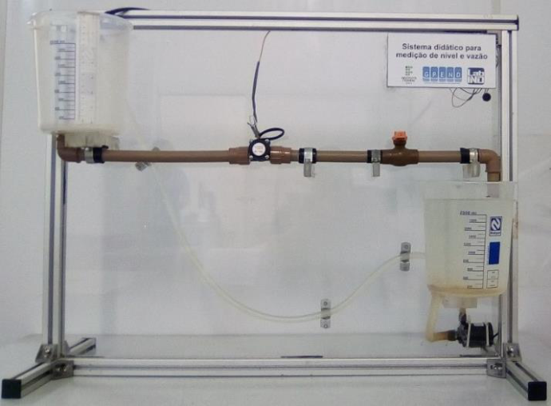

# Controle seletivo (override)

**Uma bomba, duas prioridades.** A vazão deve seguir uma referência; o reservatório de sucção deve manter nível suficiente. Quando esses objetivos competem, um seletor escolhe qual controlador envia o comando.

[Abrir no Colab](https://colab.research.google.com/drive/1vM2Ly36GAoXYpaAFQt31-j3gfqcSdEv6) · [Notebook no repositório](toolbox.ipynb)

Figura 2 do artigo indicado abaixo.

## O que muda nesta estratégia

Dois PI calculam comandos na mesma escala. O seletor **MAX** aplica o maior. Neste processo, aumentar o comando aumenta a vazão de retorno e o nível de sucção: quando o nível cai, seu PI pode assumir e elevar a vazão acima da referência. O sinal de atuação determina MAX ou MIN; não existe uma escolha universal.

Esse arranjo é um caso de controle seletivo entre **saídas de controladores**, chamado override. Selecionar o maior entre sensores é outro uso de seletor, e não é o que este notebook simula. Uma média dos dois comandos não implementa a prioridade imposta pelo MAX.

## Quando aplicar

Use quando uma variável manipulada atende um objetivo habitual, mas outra variável precisa receber prioridade perto de uma restrição. Confirme o sentido da ação, a compatibilidade das escalas e a capacidade do atuador. O controlador que não atua precisa acompanhar o comando aplicado para não acumular integral; o notebook inclui esse rastreamento.

## O artigo e os modelos

**Referência:** SILVA, Gabriel Rodrigues dos Santos; JESUS, Luis Filipe Freitas da Silva de. *Avaliação de estratégia de controle override em um módulo didático de vazão e nível*. CONTECC, Palmas, 2019. Autores do IFBA, Salvador. [PDF original, hospedado pelo Confea](https://www.confea.org.br/midias/uploads-imce/Contecc2019/Experi%C3%AAncia%20Profissional/AVALIA%C3%87%C3%83O%20DE%20ESTRATEGIA%20DE%20CONTROLE%20OVERRIDE%20EM%20UM%20MODULO%20DIDATICO%20DE%20VAZ%C3%83O%20E%20NIVEL.pdf).

O trabalho apresenta uma bancada de dois reservatórios e uma bomba, identificação experimental, sintonia IMC e seleção de alta. Extração da **Tabela 2, página 4**:

| Canal | Função de transferência | Unidade de saída | Tempo |
|---|---|---|---|
| PWM → nível | `0.1693 / (54.813 s + 1)` | cm | s |
| PWM → vazão de retorno | `0.0252 exp(-4.024 s) / (49.756 s + 1)` | L/min | s |

A unidade absoluta e o ponto de operação do PWM não estão especificados. O código usa **variações de comando**, não porcentagem de abertura. A **Tabela 1, página 3**, fornece a sintonia IMC: `Kc=(2τ+θ)/(2Kλ)`, `Ti=τ+θ/2`, com `λ=τ`. A tabela de resultados informa `Ti` em minutos; a implementação usa segundos.

## O que foi adaptado

- Planta: as duas funções de transferência publicadas, com o atraso explícito.
- Dados de identificação e validação: **gerados em simulação**, com entradas diferentes, ruído gaussiano e sementes fixas. Ganho e tempo são estimados; atraso fica fixo. Não são dados experimentais do artigo.
- Sintonia: IMC calculada a partir dos parâmetros estimados; nenhum ajuste adicional usa o ensaio de validação.
- Operação: nível inicial 8,6 cm, vazão inicial 2,45 L/min, horizonte 1000 s e comando limitado a ±40 unidades de variação são escolhas didáticas. Não reproduzem a aquisição do artigo.
- Fotografia: recorte da Figura 2, página 3. A referência acima identifica a origem; a figura conserva os direitos e a autoria de sua fonte.

## Como usar

1. Abra o notebook no Colab e execute as células em ordem.
2. Veja os parâmetros ajustados e o gráfico de validação antes da sintonia.
3. Compare “Só vazão” com “Seletor MAX” no painel.
4. Comece com vazão final 2,5 L/min; depois 1,8 L/min. O trecho laranja mostra quando o nível assume.
5. Mude o nível mínimo e o ruído. Observe qual objetivo deixa de ser atendido.

As curvas mostram a resposta do modelo; o ruído afeta as medições dos controladores. Os controles atualizam ao soltar o cursor.

## As bibliotecas

| Pacote | Papel |
|---|---|
| NumPy | Sinais, ruído e atualização exata de cada modelo de primeira ordem com entrada constante por passo |
| SciPy | Estimação por mínimos quadrados com limites positivos |
| Matplotlib | Gráficos de validação e comparação das estratégias |
| ipywidgets | Parâmetros interativos no Colab |

## Materiais de apoio

- [Controle Seletivo, Split-Range, Gain-Scheduled e Inferencial — UnB](https://www.ene.unb.br/estognetti/files/labcprocess/Apoio7_LCP_estrategias.pdf). Notas de Eduardo Stockler, 2015; páginas 2–8 mostram aplicações de seleção. Complemento conceitual, não fonte dos parâmetros deste caso.
- [Controlador PID — Parte I, canal LASC/UFSC](https://www.youtube.com/watch?v=KW4IGc9pgR0).
- [Controlador PID — Parte II, canal LASC/UFSC](https://www.youtube.com/watch?v=MZpidTSxtKI).
- [Página oficial do curso do LASC/UFSC](https://lasc.ufsc.br/curso-de-sistemas-de-controle/), que lista essas videoaulas. Os vídeos revisam PID; não são apresentados como aulas específicas de override.
- Os arquivos originais da disciplina ficam em [materiais_aula/](materiais_aula/), separados da implementação Python.

## Limites da simulação

Os modelos são lineares e locais. Não há cálculo de NPSH, cavitação, volume total ou curva hidráulica da bomba. O seletor prioriza o nível na simulação; não constitui um sistema independente de segurança. Ruído e transientes podem produzir pequenas violações do nível pretendido. Uma restrição inviável não se torna viável apenas por usar MAX.
